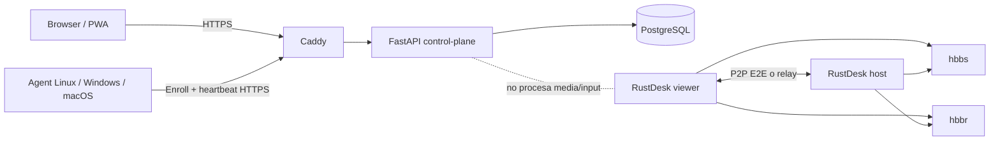

# Sarmiento

Sarmiento es una plataforma personal de control remoto para administrar tus propias computadoras desde cualquier lugar. Usa **RustDesk OSS** como motor de pantalla, teclado, mouse, audio, transferencia y relay, y agrega un **control-plane propio** para inventario, enrolamiento, presencia, seguridad, auditoría y conexión rápida.

## Estado

**Versión 1.1 implementada.** El repositorio contiene backend, panel web/PWA, agentes Linux, Windows y macOS, infraestructura Docker, HTTPS, PostgreSQL, backups, pruebas, escaneo de seguridad y CI.

La validación automática cubre el control-plane, migraciones, scripts, contenedores y agentes. La aceptación final de captura/control siempre debe ejecutarse con las máquinas reales porque permisos de pantalla, Wayland, firewalls, NAT y el protocolo local `sarmiento://` dependen del sistema operativo.

## Qué incluye

- RustDesk Server OSS self-hosted: `hbbs` + `hbbr`.
- Control-plane FastAPI + PostgreSQL.
- Login del propietario con scrypt, cookie HttpOnly, CSRF, rate limiting y lockout persistente.
- **MFA TOTP** con códigos de recuperación de un solo uso.
- JWT con emisor, audiencia, expiración, `nbf`, `jti` y versionado de sesión.
- Tokens de enrolamiento de uso único, TTL y consumo concurrente seguro.
- Credenciales independientes por agente, almacenadas únicamente como HMAC.
- Rotación automática de credenciales en dos fases, tolerante a reintentos y cortes de red.
- Heartbeat cada 30 segundos, estado online/offline e inventario técnico acotado.
- Panel responsive instalable como PWA.
- Conexión 1-click mediante `sarmiento://` y copia de ID como fallback.
- Administración de alias, etiquetas, revocación y auditoría.
- Instaladores para Linux/systemd, Windows/Scheduled Tasks y macOS/launchd.
- HTTPS automático con Caddy y headers CSP/HSTS.
- Límites de body HTTP y metadata para reducir abuso de memoria/DB.
- Migraciones Alembic, backups, restore, smoke tests, GitHub Actions, Bandit y `pip-audit`.

## Arquitectura



El control-plane **no procesa video ni eventos de entrada** y **no guarda la contraseña permanente de RustDesk**. Esa contraseña se genera/configura en la máquina controlada y se muestra una sola vez durante la instalación.

Documentación técnica:

- [`docs/ARCHITECTURE.md`](docs/ARCHITECTURE.md): arquitectura, componentes, secuencias, estados y ER.
- [`docs/UML.md`](docs/UML.md): casos de uso, componentes, despliegue y actividades.
- [`docs/THREAT_MODEL.md`](docs/THREAT_MODEL.md): STRIDE, trust boundaries y escenarios de abuso.
- [`docs/SECURITY_AUDIT.md`](docs/SECURITY_AUDIT.md): hallazgos, correcciones y riesgos residuales.
- [`docs/SECURITY.md`](docs/SECURITY.md): controles y respuesta a incidentes.
- [`docs/DEPLOYMENT.md`](docs/DEPLOYMENT.md), [`docs/OPERATIONS.md`](docs/OPERATIONS.md) y [`docs/ACCEPTANCE.md`](docs/ACCEPTANCE.md).

## Requisitos de despliegue

- Servidor Linux con Docker Engine y Docker Compose.
- IP pública o VPS accesible desde las máquinas viewer y host.
- Dominio para el panel, por ejemplo `control.example.com`.
- Hostname o IP para RustDesk, por ejemplo `desk.example.com`.
- Puertos:
  - `80/tcp`, `443/tcp`, `443/udp` para panel y HTTPS.
  - `21115/tcp`.
  - `21116/tcp` y `21116/udp`.
  - `21117/tcp`.
  - `21118/tcp` y `21119/tcp` si se conserva soporte web de RustDesk.

## Instalación del servidor

```bash
git clone https://github.com/SaintWyss/Sarmiento.git
cd Sarmiento

python3 ops/init_env.py \
  --site-address https://control.example.com \
  --rustdesk-server desk.example.com \
  --owner owner

make up
make smoke URL=https://control.example.com
```

El generador crea `infra/.env` con permisos `0600`, contraseña de PostgreSQL, secreto de sesión y pepper independientes. Si no ingresás una contraseña de propietario de forma interactiva, genera una y la muestra una sola vez.

Después del primer login, abrí **Seguridad** y activá MFA antes de exponer el panel de forma permanente. Una vez creado el owner y cambiada su contraseña desde el panel, `SARMIENTO_OWNER_PASSWORD` puede quedar vacío en `infra/.env`.

## Enrolar una máquina

El panel crea un token temporal y muestra el comando exacto.

Linux:

```bash
curl -fsSL https://control.example.com/agent/install-linux.sh | \
  sudo bash -s -- --url https://control.example.com --token 'set_...'
```

Windows PowerShell como administrador:

```powershell
iwr https://control.example.com/agent/install-windows.ps1 -UseBasicParsing | iex
Install-SarmientoAgent -Url 'https://control.example.com' -Token 'set_...'
```

macOS, con RustDesk instalado en `/Applications`:

```bash
curl -fsSL https://control.example.com/agent/install-macos.sh | sudo bash -s -- \
  --url https://control.example.com --token 'set_...'
```

Los instaladores:

1. Instalan o verifican RustDesk 1.4.9.
2. Configuran ID Server y clave pública.
3. Generan una contraseña permanente aleatoria.
4. Obtienen el RustDesk ID.
5. Enrolan el equipo.
6. Instalan heartbeat persistente.
7. Muestran la contraseña para guardarla en un gestor de contraseñas.

## Uso desde celular

1. Instalá el cliente oficial de RustDesk.
2. Configuralo con el mismo ID Server y clave pública.
3. Abrí Sarmiento o instalalo como PWA.
4. Pulsá **Conectar**. Si el sistema no abre el deep link, copiá el ID y pegalo en RustDesk.

## Desarrollo y validación

```bash
python3 -m venv .venv
. .venv/bin/activate
pip install -e 'control-plane[dev]'

make test
make check
```

Prueba local:

```bash
cd control-plane
SARMIENTO_OWNER_PASSWORD='a-secure-local-password' \
SARMIENTO_SESSION_SECRET='replace-with-at-least-32-random-bytes' \
SARMIENTO_TOKEN_PEPPER='a-different-long-random-secret' \
SARMIENTO_STATIC_DIR='../front' \
SARMIENTO_AGENT_DIR='../agent' \
SARMIENTO_VIEWER_DIR='../viewer' \
uvicorn sarmiento.main:app --reload
```

## Operación

```bash
make logs
make ps
make backup
./ops/restore.sh backups/20260712T120000Z
```

## Versiones fijadas

- Sarmiento control-plane: `1.1.0`.
- RustDesk client: `1.4.9` en instaladores.
- RustDesk server OSS: `1.1.15`.
- PostgreSQL: `16.4-alpine`.
- Python: `3.12`.

No se usa `latest` en producción. Las actualizaciones se aplican por PR, CI y aceptación en hardware. Para despliegues de mayor criticidad, además se deben fijar imágenes por digest `sha256`.

## Licencias

El código propio de Sarmiento se publica bajo MIT. RustDesk se ejecuta como dependencia independiente y conserva su licencia AGPL-3.0-or-later. Ver [`THIRD_PARTY_NOTICES.md`](THIRD_PARTY_NOTICES.md).
