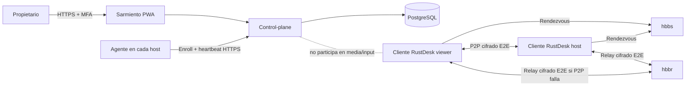
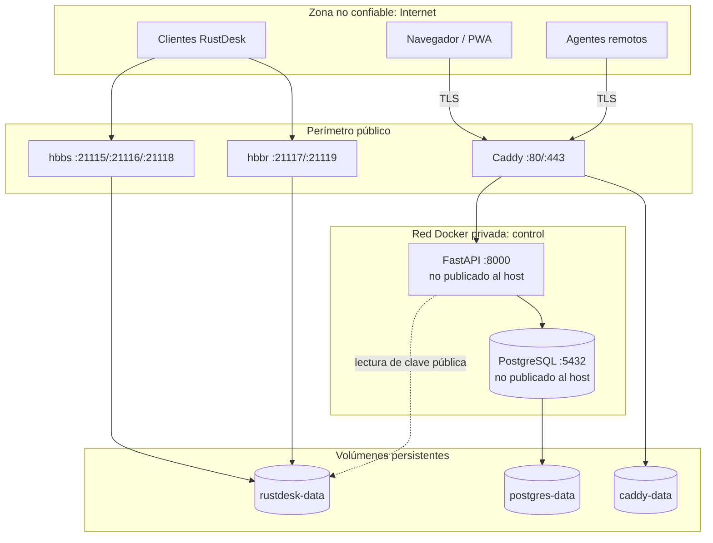
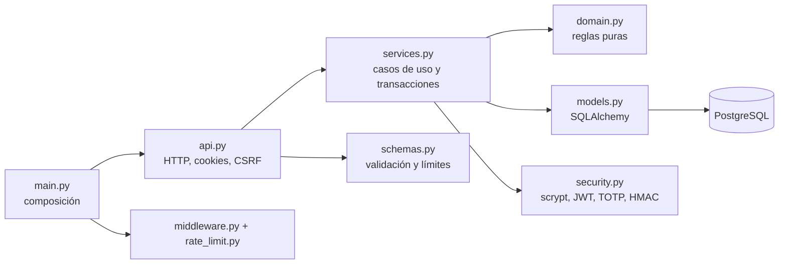
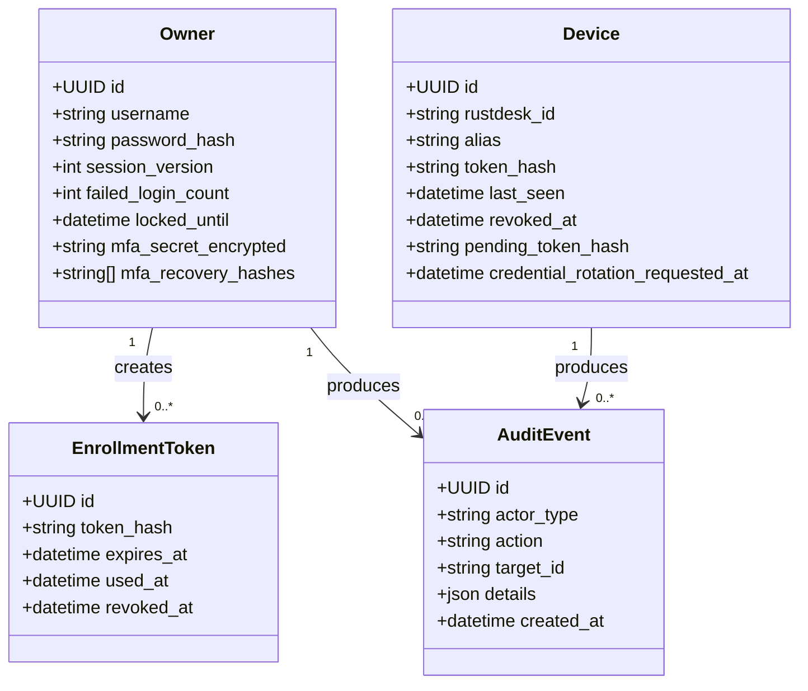
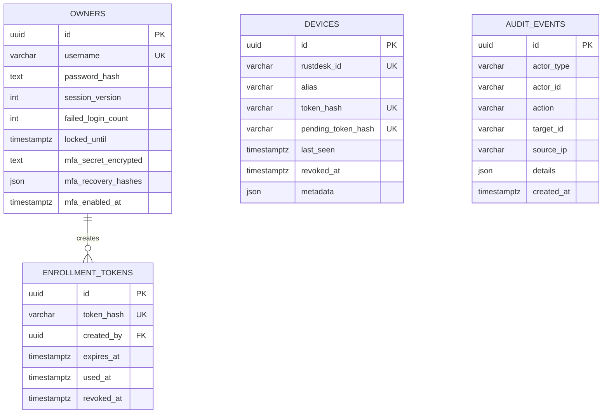
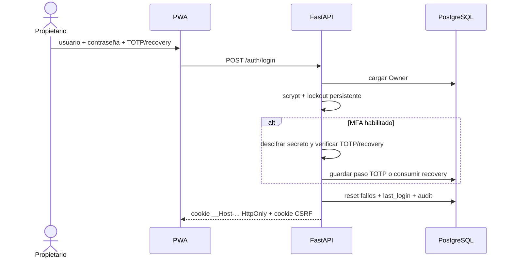
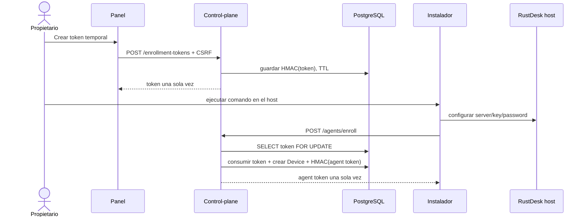
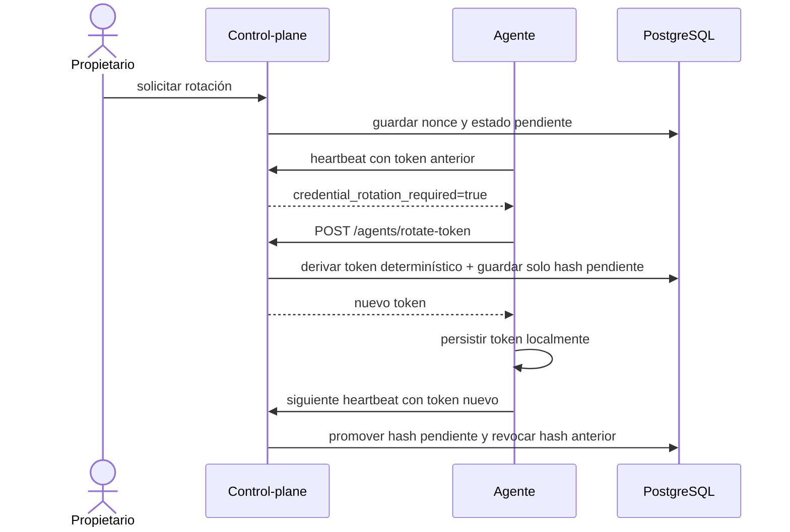
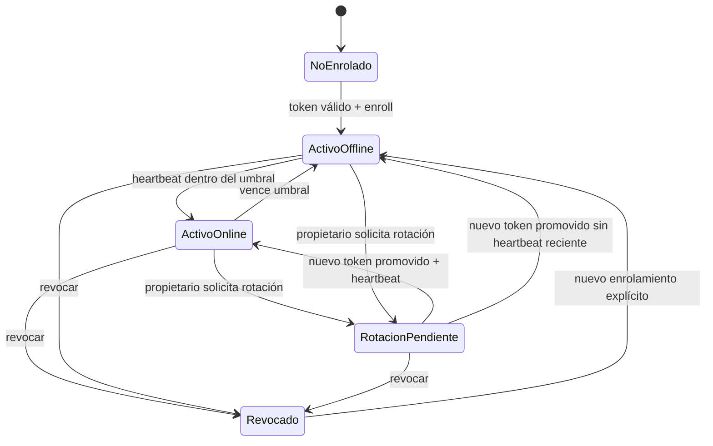

# Arquitectura de Sarmiento 1.1

Sarmiento separa deliberadamente el **plano de control** del **plano de datos remoto**. El control-plane administra identidad, inventario, presencia y auditoría. RustDesk OSS transporta pantalla, entrada, audio y archivos mediante cifrado extremo a extremo, P2P o relay.

## Principios y límites

1. Sarmiento no reimplementa captura, codecs, NAT traversal ni input remoto.
2. PostgreSQL es la única fuente de verdad del control-plane.
3. `hbbs` no se consulta: la presencia se deriva del heartbeat autenticado del agente.
4. La contraseña permanente de RustDesk nunca entra al control-plane.
5. Tokens de enrolamiento y agente se persisten únicamente como HMAC-SHA-256 con pepper.
6. El propietario es único; no existe multi-tenancy ni RBAC en 1.1.
7. El canal de administración exige HTTPS, cookies seguras, CSRF y MFA opcional recomendado.

## Contexto del sistema

## Contenedores y zonas de confianza

La cabecera `X-Forwarded-For` se confía porque el API no publica puertos y solo Caddy comparte la red `control`. Publicar `api:8000` directamente invalidaría este supuesto de seguridad.

## Componentes del control-plane

## Modelo de dominio

## Modelo de persistencia

## Secuencia de login con MFA

## Secuencia de enrolamiento

## Rotación tolerante a fallos

## Estado del dispositivo

## Decisiones no funcionales

- **Disponibilidad:** contenedores con healthchecks y `restart: unless-stopped`.
- **Consistencia:** migraciones Alembic; locks de fila para consumo y rotación.
- **Seguridad:** scrypt, MFA TOTP, recuperación de un uso, cookies `__Host-`, CSRF, CSP, HSTS, límites de cuerpo y metadata.
- **Observabilidad:** health/readiness, auditoría estructurada y logs JSON de Caddy.
- **Escala:** una instancia API prevista. Para múltiples workers se debe mover rate limiting a Redis, manteniendo PostgreSQL como autoridad.
