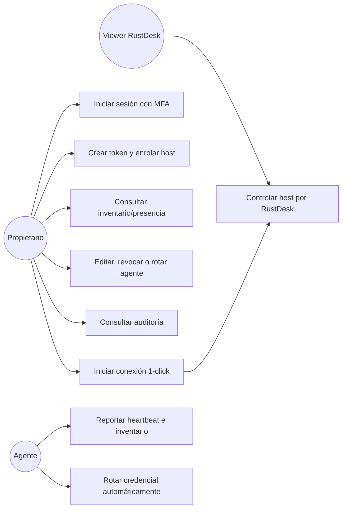
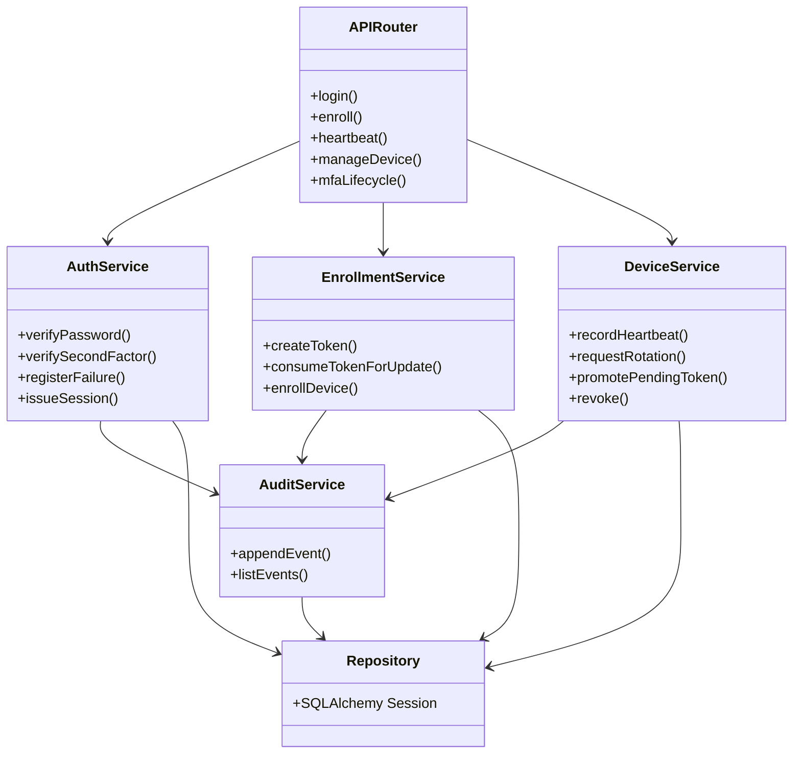
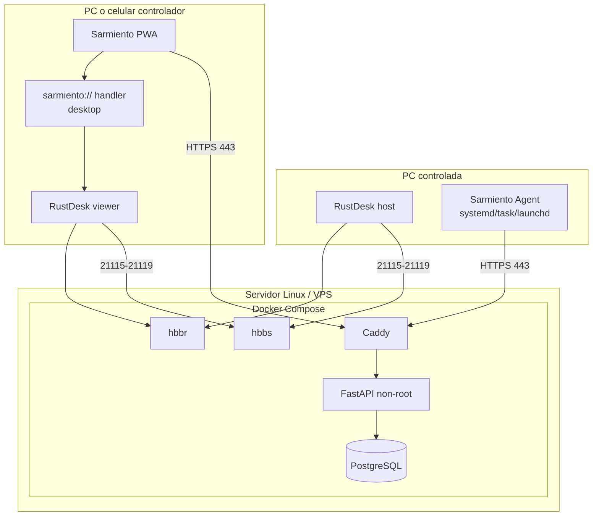
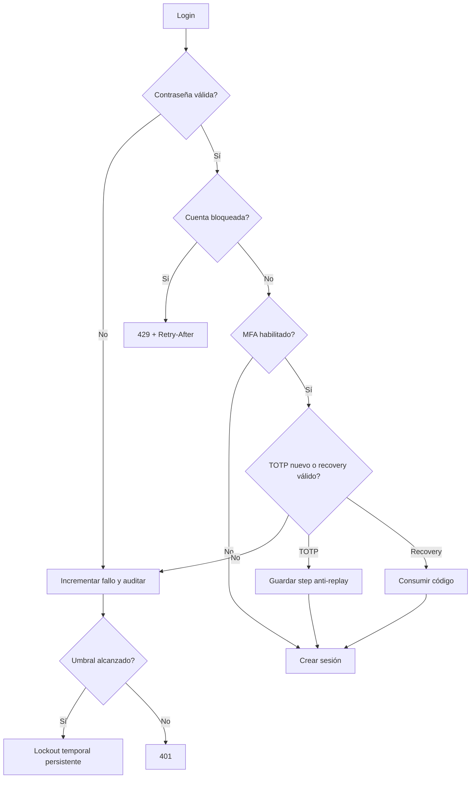

# UML y diagramas de comportamiento

Este documento concentra vistas UML complementarias a [`ARCHITECTURE.md`](ARCHITECTURE.md).

## Casos de uso

## Diagrama de componentes

## Despliegue UML

## Actividad de recuperación de acceso

