# 04 — Diagramas UML

## Propósito

Yo uso UML para separar actores, estructura, mensajes, estados y despliegue. Sarmiento combina web, desktop, agentes y servicios externos; sin varias vistas, es fácil confundir quién autentica, quién controla y quién transporta la sesión remota.

## Cobertura UML 2

| Tipo | Cobertura | Aplicación |
|---|---|---|
| casos de uso | incluida | owner, agentes y equipos |
| clases | incluida | identidad, dispositivo y rotación |
| objetos | incluida | equipo enrolado concreto |
| componentes | incluida | control-plane, clientes y servicios |
| paquetes | incluida | backend y adaptadores |
| estructura compuesta | incluida | interior de la app desktop |
| despliegue | incluida | servidor, PCs y red |
| actividad | incluida | enrolamiento y modo estación |
| estados | incluida | dispositivo y rotación |
| secuencia | incluida | login, enrolamiento y conexión |
| comunicación | incluida | mensajes principales |
| visión general de interacción | incluida | recorrido completo |
| temporal | incluida | heartbeat y rotación |
| perfil | incluida | estereotipos de seguridad |

## 1. Casos de uso

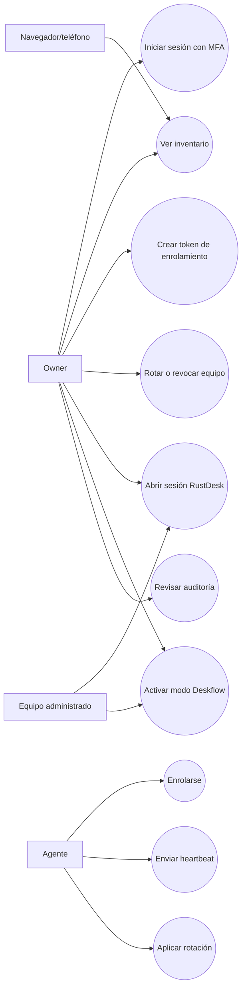

## 2. Clases de dominio

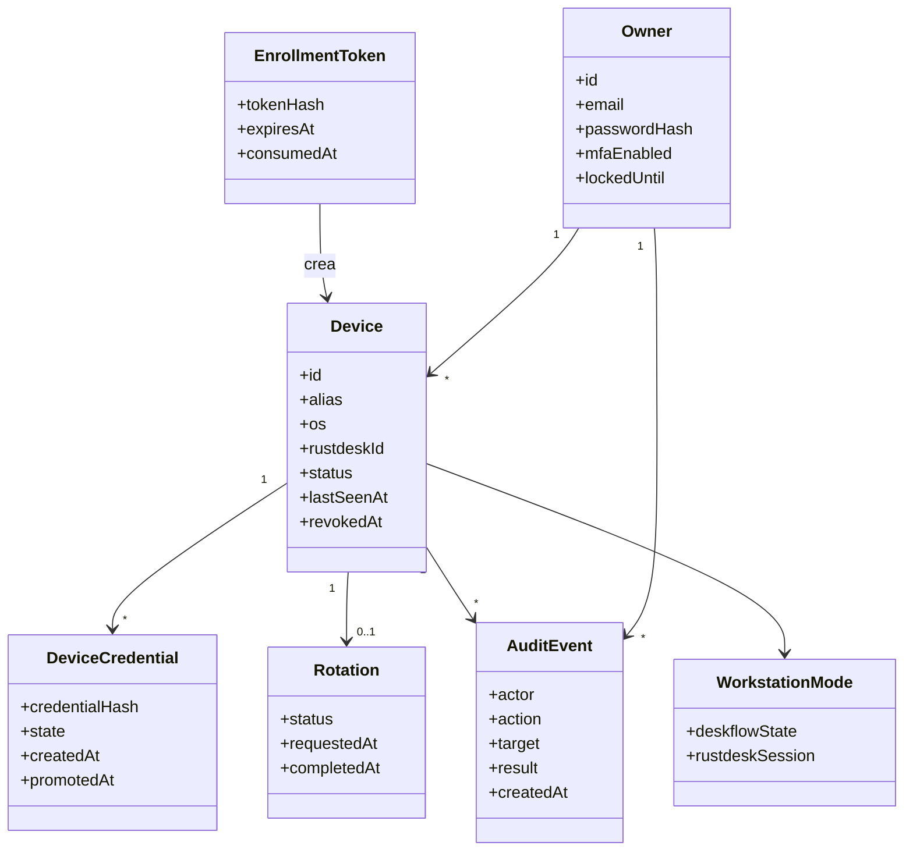

## 3. Objetos de un equipo

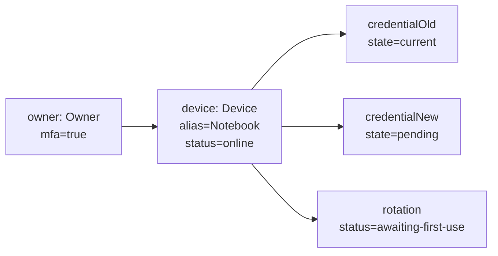

## 4. Componentes

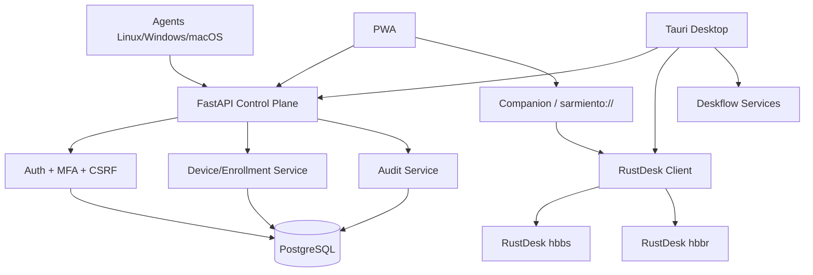

## 5. Paquetes backend

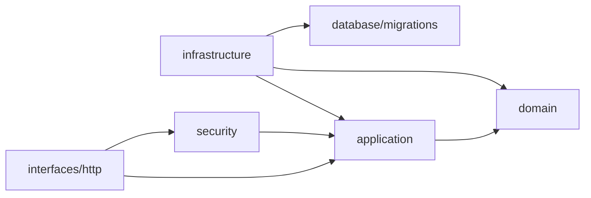

## 6. Estructura compuesta de la app desktop

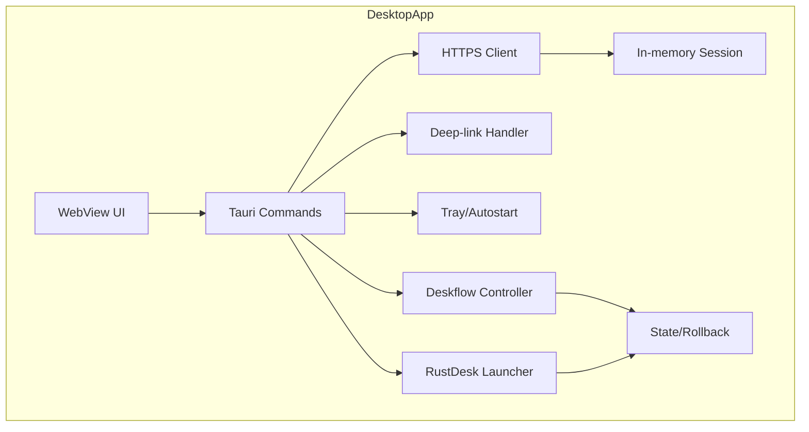

## 7. Actividad de enrolamiento

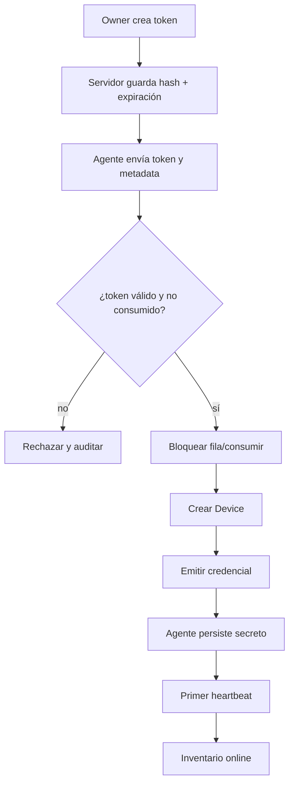

## 8. Actividad de “Abrir en monitor”

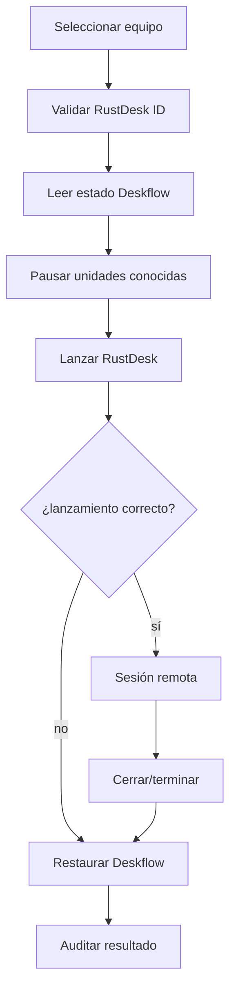

## 9. Máquina de estados del dispositivo

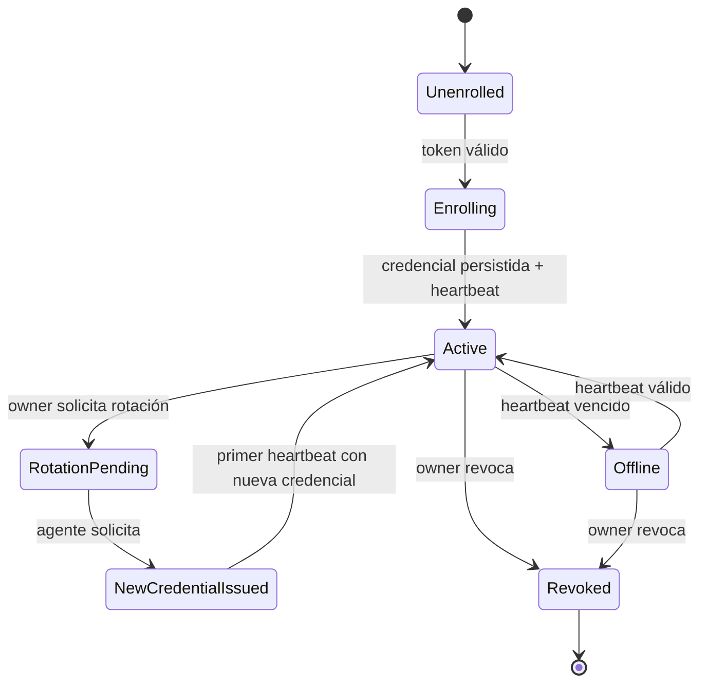

## 10. Secuencia de login

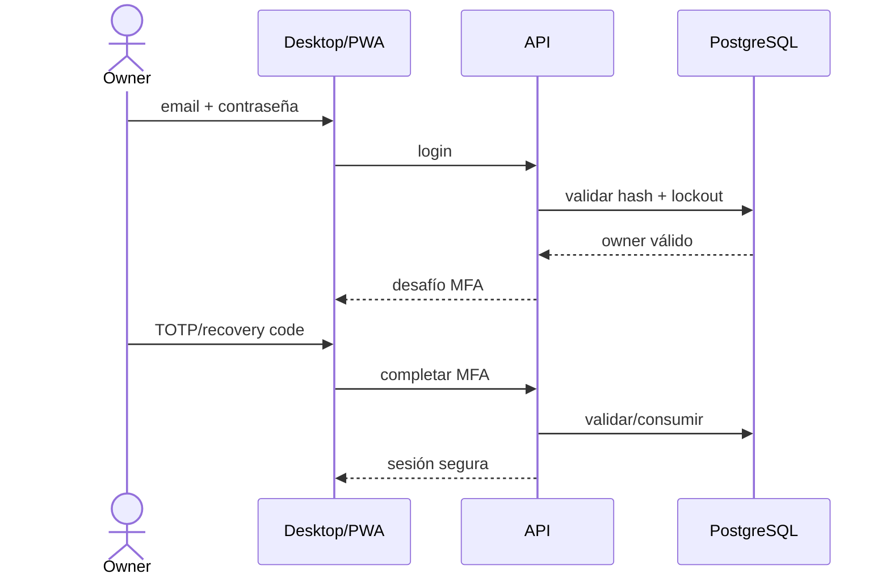

## 11. Secuencia de rotación tolerante a fallos

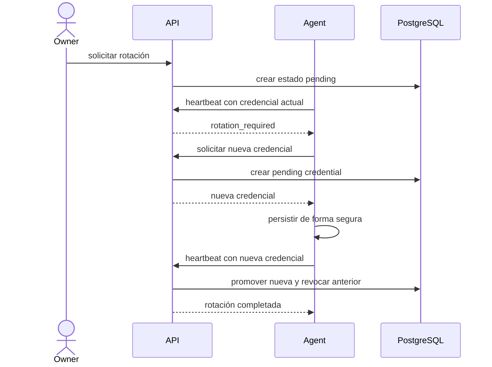

## 12. Comunicación

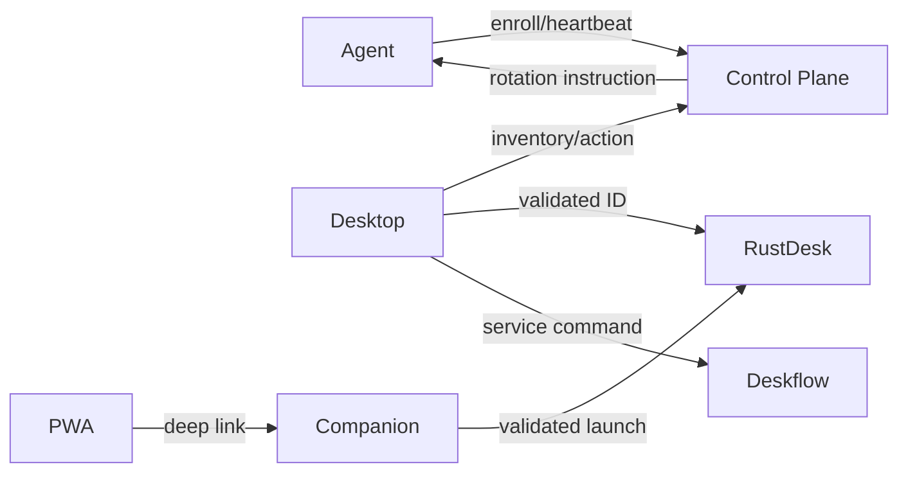

## 13. Visión general de interacción

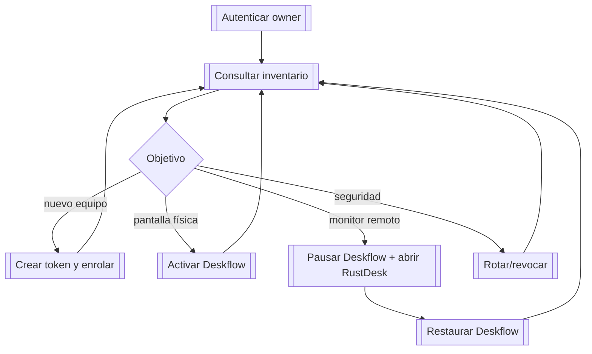

## 14. Temporal: heartbeat y presencia

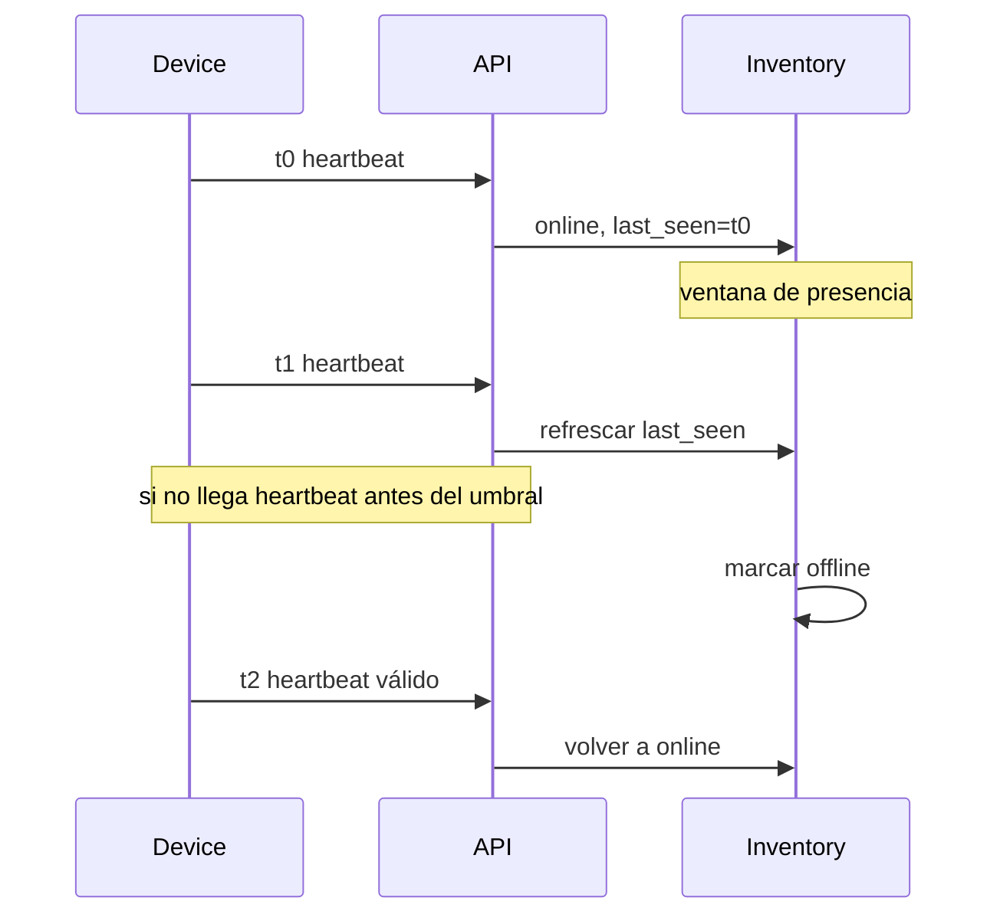

## 15. Despliegue

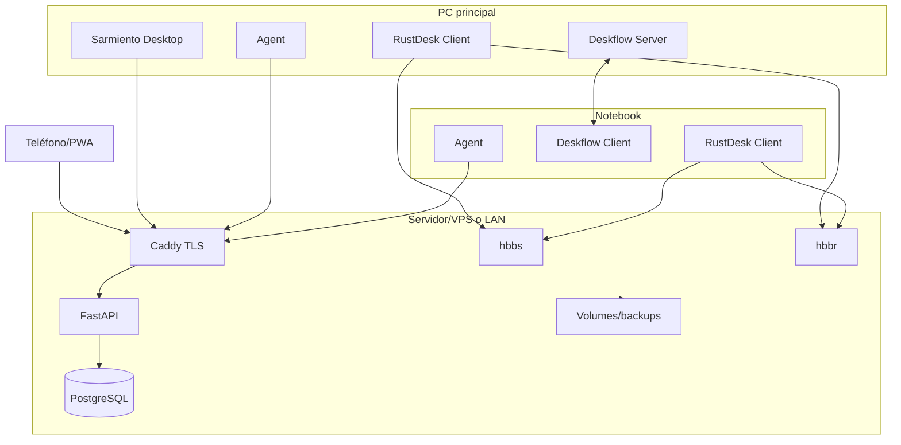

## 16. Perfil UML de seguridad

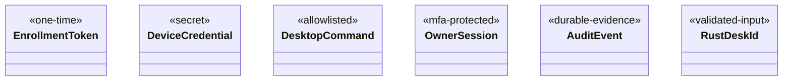

## Regla de mantenimiento

Yo actualizo estas vistas cuando cambia un actor, estado de dispositivo, protocolo de rotación, acción desktop, servicio o nodo de despliegue. Los diagramas técnicos existentes complementan estas vistas para implementación detallada.